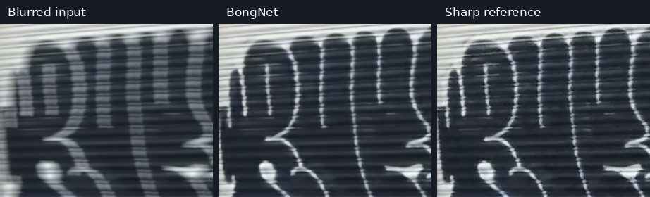
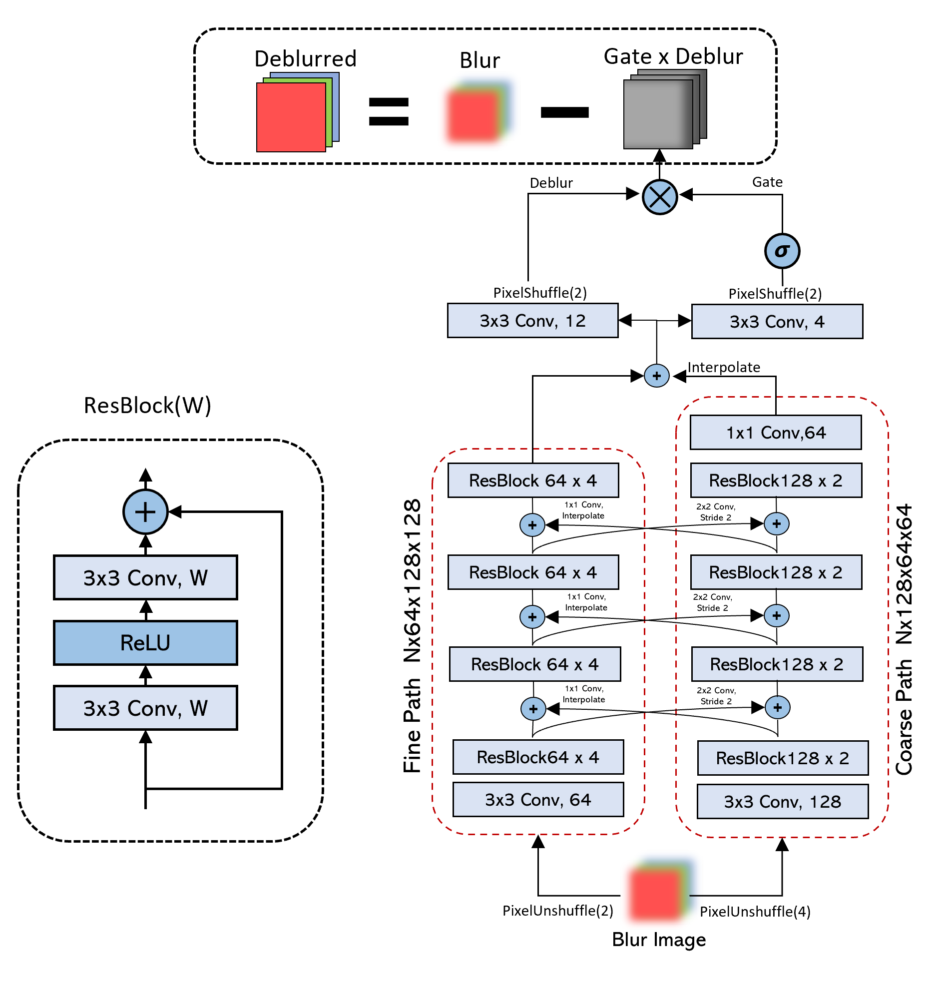
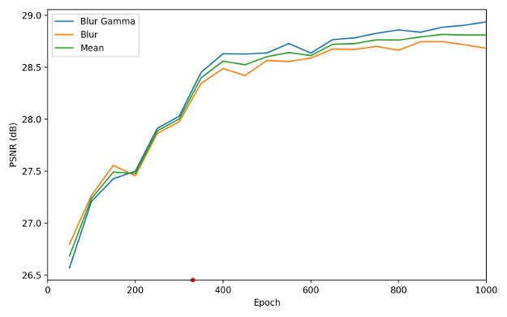
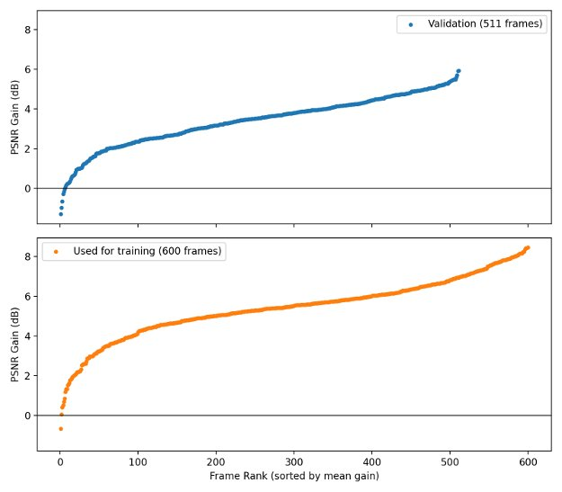
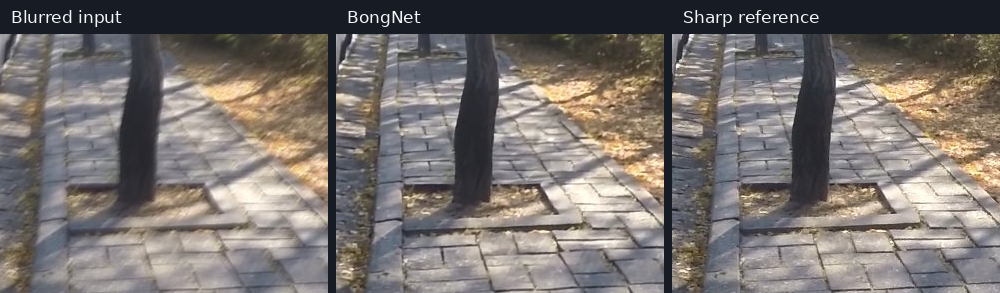

# BongNet

BongNet is a PyTorch model I built for an image deblurring competition in an AI course. It processes a blurry RGB image at two resolutions and predicts a pixelwise correction. The model has **3,746,384 parameters**. On my 511-frame GoPro validation split, the epoch-900 checkpoint raised mean PSNR from **25.4284 to 28.8164 dB**.



*GoPro training frame `GOPR0385_11_01/003106` (`blur_gamma`). BongNet separates several of the white contours on the shutter, though the finest edges are softer than in the sharp reference.*

## Architecture

Looking through the training pairs, I found that blur could vary considerably within a single image. I used the input image as a global skip connection and gave the network two output heads. One predicts a signed RGB correction $D$, and the other predicts a one-channel sigmoid gate $G$ shared across the RGB channels at each pixel.

$$
\hat I = I_{\mathrm{blur}} - G \odot D
$$

The correction head starts at zero, so the initial network copies its input. The gate then gives the trained model a way to scale the correction at each pixel.

The two paths were inspired by AlexNet's feature exchanges between parallel branches. In BongNet, the split gives the paths different spatial resolutions. `PixelUnshuffle` moves each $2\times2$ or $4\times4$ neighborhood into channels. The first $3\times3$ convolution covers $6\times6$ input pixels on the fine path and $12\times12$ on the coarse path, away from the image boundary. [AlexNet paper](https://papers.nips.cc/paper/4824-imagenet-classification-with-deep-convolutional-neural-networks)

| Path | Rearranged RGB input | Feature map for a 256 × 256 patch | Residual blocks |
| --- | --- | --- | --- |
| Fine | `PixelUnshuffle(2)` | 64 × 128 × 128 | 4 per stage, 16 total |
| Coarse | `PixelUnshuffle(4)` | 128 × 64 × 64 | 2 per stage, 8 total |

Each residual block uses two $3\times3$ convolutions with a ReLU between them. The paths exchange features after the first three stages. Fine-to-coarse uses a $2\times2$ stride-2 convolution. Coarse-to-fine uses a $1\times1$ projection followed by bilinear upsampling. After stage four, the coarse features are added to the fine path one last time. Both output heads use `PixelShuffle(2)` to return to the input resolution.



### Early design checks

Replacing average pooling and a $1\times1$ projection with the stride-2 convolution raised mean validation PSNR from 26.0692 to 26.1345 dB across epochs 116–120 on the same split. That change added 73,728 parameters. In a separate five-image check at epoch 30, the gate raised mean PSNR from 25.655 to 25.669 dB. The gate comparison ended at that early checkpoint.

## Training and validation

I regrouped GOPRO_Large by recording. Training used 2,703 sharp frames, including 600 from the original GoPro test partition. The 511 validation frames came from five recordings reserved for checkpoint selection (`GOPR0396`, `GOPR0410`, `GOPR0854`, `GOPR0862`, and `GOPR0869`). Each training frame contributed one of `blur` or `blur_gamma` per epoch, sampled with equal probability. Training used paired 256 × 256 random crops and horizontal flips. Validation evaluated both variants at full resolution.

| Epochs | Training objective | Adam learning rate |
| --- | --- | --- |
| 1–330 | L1 | `1e-4` |
| 331–1,000 | Mean of per-image `log(MSE + 1e-8)` | `3e-5` |

I switched to log-MSE to bring the late-stage objective closer to mean per-image PSNR. The learning rate changed at the same time. Training used batch size 2 and CUDA mixed precision on an RTX 2060 SUPER (8 GB). The run took about 17 hours 50 minutes including validation.

| Epoch | Mean validation PSNR |
| ---: | ---: |
| 50 | 26.6857 dB |
| 300 | 28.0029 dB |
| 350 | 28.3982 dB |
| **900** | **28.8164 dB** |
| 1,000 | 28.8103 dB |

Epoch 900 had the highest mean PSNR among the 22 evaluated checkpoints. On the 511 validation frames, the mean gain was **+3.3880 dB**, with **505 of 511** frames improving after averaging the gains of the two blur variants. Mean gain was +3.1186 dB on `blur` and +3.6574 dB on `blur_gamma`. These scores apply to the custom validation split.



<details>
<summary>Per-frame PSNR gains</summary>



Each point averages the gain of the two blur variants for one frame. The 600 previously seen frames and the 511 validation frames are plotted separately.

</details>

### When PSNR drops



BongNet makes the paving joints easier to see in this example from the report. The full-frame PSNR still dropped by 1.41 dB. A single score across the image can miss changes like this in a small region.

## Run

Install the dependencies, then point the training script at the extracted GOPRO_Large folder containing `train/` and `test/`.

```bash
python -m pip install -r requirements.txt
python train.py --data-root /path/to/GOPRO_Large --output-dir checkpoints
```

The training script saves weights every five epochs. Supply your own BongNet checkpoint for inference. The original epoch-900 weights are currently unavailable in this repository.

```bash
python inference.py input.png --weights checkpoints/epoch_0900.pt --output restored.png
```

Use matching IDs in the `blur_*.png` and `sharp_*.png` filenames when scoring paired images.

```bash
python test.py --blur-dir test/blur --sharp-dir test/sharp --weights checkpoints/epoch_0900.pt --output-dir test/restored
```

For a folder of images without sharp references, add `--inference-only` and set `--blur-pattern "*.png"` if the filename prefix differs.

## Data credit

The comparisons show crops from GOPRO_Large by Seungjun Nah, Tae Hyun Kim, and Kyoung Mu Lee (CVPR 2017). BongNet produced the center panels. [GoPro dataset](https://seungjunnah.github.io/Datasets/gopro.html) · [CC BY 4.0](https://creativecommons.org/licenses/by/4.0/)
